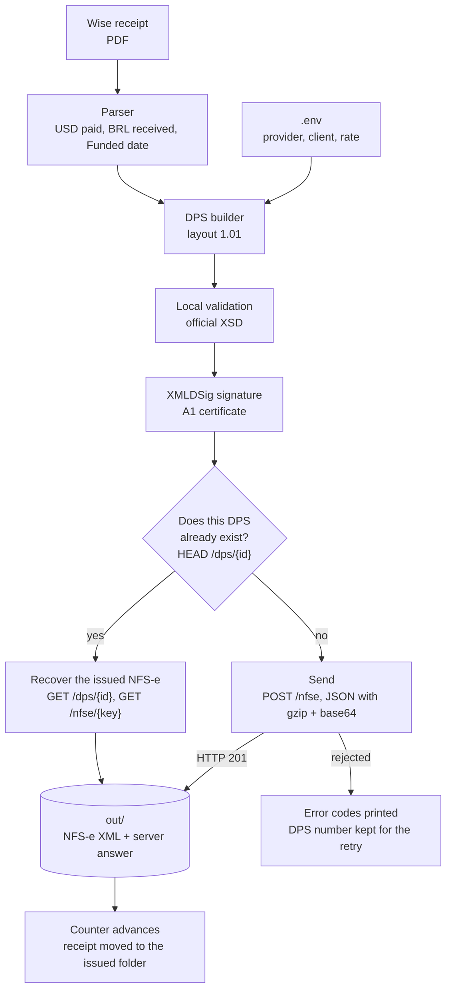

<h1 align="center">nfse-exportacao-servicos</h1>

<p align="center">
  <b>Issues Brazilian electronic service invoices (NFS-e) for services exported abroad, straight from Wise payment receipts.</b><br>
  One command per batch: read the receipt, build the invoice, validate it, sign it, send it over mutual TLS, keep the result.
</p>

<p align="center">
  
  
  
  
  
  
</p>

<p align="center">
  <a href="docs/gotchas.md">Server rejections and fixes</a> ·
  <a href="skill/SKILL.md">Agent skill</a> ·
  <a href=".env.example">Configuration template</a> ·
  <a href="docs/">Official specifications</a>
</p>

> [!IMPORTANT]
> **An invoice issued in production is a legal document.** Start in the government's test environment
> (`NFSE_AMBIENTE=producaorestrita`), and confirm the service code, the tax regime and the rate with an
> accountant before the first real invoice. Nothing in this repository is tax or accounting advice.

> [!NOTE]
> **Em português.** Emissão automática de NFS-e no Sistema Nacional NFS-e (Sefin Nacional) para
> exportação de serviços, a partir dos comprovantes da Wise: leitura do PDF, DPS no leiaute 1.01
> validada contra o XSD oficial, assinatura XMLDSig com certificado A1 e envio por mTLS. O código, as
> mensagens da linha de comando e as notas técnicas ([`docs/gotchas.md`](docs/gotchas.md)) estão em
> português.

## What this repository shows

- **A government API integrated from its specification.** The invoice layout comes from the official
  XSD schemas, the business rules from a spreadsheet annex of about 650 rules (Anexo I), and the
  API description is served only to a client holding a government-issued certificate. Every one of them
  is in [`docs/`](docs/).
- **Rules that live outside the schema, found and written down.** An invoice that passes the XSD can
  still be rejected. Each rejection met on the way is recorded with its error code, its cause and its
  fix in [`docs/gotchas.md`](docs/gotchas.md), and summarised [below](#what-the-server-rejects).
- **A signature built by hand.** The server accepts the signature only without a namespace prefix and
  with exclusive canonicalisation, a form the `signxml` library does not produce, so the enveloped
  signature is assembled with `cryptography` and `lxml`.
- **Safe against a dangerous server behaviour.** Sending a second invoice for an identifier that already
  has one triggers an automatic cancellation by substitution. Before every submission the client asks
  the server whether the identifier exists, and if it does, recovers the invoice instead of sending.
- **Operated by an AI agent with a human in the loop.** [`skill/SKILL.md`](skill/SKILL.md) is the runbook
  under which an AI coding agent (Claude Code) runs the tool: checks before a batch, a plan with every
  amount shown to the user, confirmation before production, and the table of server errors.

**Contents:** [What this repository shows](#what-this-repository-shows) · [At a glance](#at-a-glance) ·
[Terms](#terms) · [How it works](#how-it-works) · [What the server rejects](#what-the-server-rejects) ·
[Quick start](#quick-start) · [Configuration](#configuration) · [Command line](#command-line) ·
[Safety model](#safety-model) · [Repository layout](#repository-layout) · [Documentation](#documentation) ·
[Scope and limits](#scope-and-limits) · [Licence](#licence-and-disclaimer)

---

## At a glance

| | |
|---|---|
| **What it does** | Turns each Wise payment receipt into an authorised NFS-e, issued through the national API (Sefin Nacional) |
| **For whom** | A Brazilian company in the Simples Nacional regime (ME/EPP) that provides a service to one client abroad and is paid through Wise |
| **Input** | Wise "transfer confirmation" PDFs, in English, one per payment |
| **Output** | The authorised invoice (XML) and the server's full answer (JSON) in `out/`, one pair per receipt |
| **Tax treatment** | Export of services: the municipal service tax (ISS) is not levied, the client's country is where the result is verified, service code 1.04 (software development) |
| **Standards** | DPS layout 1.01, validated locally against the official XSD; XMLDSig enveloped signature (exclusive canonicalisation, RSA-SHA1); mutual TLS with an ICP-Brasil A1 certificate |
| **Environments** | The test environment (`producaorestrita`) and production (`producao`), each with its own invoice counter |
| **State** | Version 0.1, in production use since May 2026 |

## Terms

| Term | Meaning |
|---|---|
| **NFS-e** | *Nota Fiscal de Serviços eletrônica*: the electronic invoice a Brazilian company issues for a service |
| **Sefin Nacional** | The national NFS-e system run by the federal government, which a municipality may join instead of keeping its own |
| **DPS** | *Declaração de Prestação de Serviço*: the signed XML the provider sends; the server answers with the NFS-e |
| **DANFSe** | The PDF rendering of an NFS-e, for people to read |
| **Simples Nacional, ME/EPP** | Brazil's simplified tax regime for small companies (*microempresa* / *empresa de pequeno porte*), with one combined monthly tax |
| **ISS** | The municipal service tax; not levied on services exported abroad |
| **LC 116** | The federal list of service codes; 1.04 is the development of computer programs (`cTribNac` 010401 in the national system) |
| **PTAX** | The Central Bank of Brazil's reference USD/BRL exchange rate |
| **NIF** | The client's tax number abroad (an EIN in the US); the DPS may state that none is required |
| **ICP-Brasil A1** | A digital certificate of the Brazilian public-key infrastructure, held as a file (`.pfx`), which signs the DPS and authenticates the connection |

## How it works



1. **Read the receipt.** `pdfplumber` extracts the text of the Wise PDF. The parser takes the transfer
   number, the "Funded" date (the date of competence), the amount paid in USD and the amount received
   in BRL. A receipt that carried only USD would be converted at the PTAX selling rate of that day, or of
   the last business day before it.
2. **Build the DPS.** The identifier of 45 characters is composed from the municipality, the company's
   CNPJ, the series and the number. The provider block carries no address (the server reads it from the
   CNPJ register), the client is described by a foreign address, and the foreign-trade block states a
   cross-border service in US dollars.
3. **Validate locally.** The DPS is checked against the official XSD before anything leaves the machine.
   Some patterns of the official `tiposSimples_v1.01.xsd` carry literal `^` and `$` anchors, which XSD
   does not treat as metacharacters, so they are removed in memory before validation.
4. **Sign.** The enveloped signature uses the default namespace, exclusive canonicalisation and
   RSA-SHA1, with the certificate in `KeyInfo`.
5. **Send once.** The client first asks whether the DPS exists. If it does, the issued invoice is
   recovered and saved. If it does not, the signed XML is gzipped, base64-encoded, wrapped in JSON and
   posted over mutual TLS.
6. **Record.** On HTTP 201 the invoice is saved in `out/`, the counter advances, and in batch mode the
   receipt moves to the issued folder. On a rejection the server's error codes are printed and the
   number stays free for the corrected retry.

Example of a batch run, with fictitious data. The messages are the program's own, in Portuguese:

```text
$ PYTHONPATH=src .venv/bin/python -m nfse_exportacao.main --batch recibos --mover-para recibos/emitidas
Ambiente: producao
Lote: 2 PDF(s) em recibos
Após sucesso, move para: recibos/emitidas

=== wise_transfer_0001.pdf ===
  ✓ emitida nDPS=12 chave=<access key, 50 digits>
  → movido para recibos/emitidas/wise_transfer_0001.pdf

=== wise_transfer_0002.pdf ===
  ✓ emitida nDPS=13 chave=<access key, 50 digits>
  → movido para recibos/emitidas/wise_transfer_0002.pdf

Resumo: 2 sucesso(s), 0 falha(s)
```

## What the server rejects

None of these is visible in the XSD. They come from the server's answers and from the rules of
Anexo I. Details in [`docs/gotchas.md`](docs/gotchas.md).

| Error | What triggers it | What the code does |
|---|---|---|
| **E1228** | A namespace prefix on the signature (`<ds:Signature>`) | Writes `<Signature xmlns="http://www.w3.org/2000/09/xmldsig#">` with the default namespace |
| **E0714** | Inclusive canonicalisation, the usual choice for Brazil's goods invoices | Uses exclusive canonicalisation (`xml-exc-c14n#`) |
| **E0004** | An identifier that does not match the fields | Builds the identifier with `tpInsc=2` for a CNPJ (1 is a CPF, against intuition) |
| **E0128** | The provider's address, when the provider is the one issuing | Leaves the address out of the provider block |
| **E0166** | A Simples Nacional ME/EPP provider without `regApTribSN` | Always writes it after `opSimpNac=3` |
| **E0006** | An environment flag that differs from the endpoint | Derives `tpAmb` from `NFSE_AMBIENTE` |
| **E0712** | Omitting the approximate taxes (`indTotTrib`) for an ME/EPP | Writes them in reais (`vTotTrib`); the percentage form is accepted but leaves the DANFSe fields blank |
| **415** | Raw XML in the body | Sends JSON: `{"dpsXmlGZipB64": "<gzip + base64 of the signed XML>"}` |
| *(no error)* | Sending a DPS whose invoice already exists | **Cancels the existing invoice by substitution.** The client checks `HEAD /dps/{id}` first and never resends |

For an export, the municipal tax group carries only `tribISSQN=3`, the country of the result and
`tpRetISSQN=1`. The rate, the immunity, the suspension and the tax-base fields are forbidden there.

## Quick start

Needs Python 3.13 (the version it runs on), an ICP-Brasil A1 certificate of the company (e-CNPJ) as a
`.pfx` file, and a municipality that has joined the national NFS-e system.

```bash
git clone https://github.com/llatoski/nfse-exportacao-servicos.git
cd nfse-exportacao-servicos

python3 -m venv .venv && .venv/bin/pip install -r requirements.txt
cp .env.example .env        # fill in the provider, the client and the certificate; keep producaorestrita

PYTHONPATH=src .venv/bin/python -m nfse_exportacao.main --peek                 # next DPS number
PYTHONPATH=src .venv/bin/python -m nfse_exportacao.main recibos/wise_0001.pdf  # one invoice, test environment
```

Switch to `NFSE_AMBIENTE=producao` only after an invoice has been accepted in the test environment. The
two environments keep separate counters.

## Configuration

Everything specific to a company lives in `.env` (git-ignored). [`.env.example`](.env.example) lists
every variable with placeholder values.

| Group | Variables | Notes |
|---|---|---|
| **Certificate** | `CERT_PATH`, `CERT_PASSWORD` | The A1 `.pfx` file and its password |
| **Environment** | `NFSE_AMBIENTE`, `NFSE_BASE_URL_HOMOLOG`, `NFSE_BASE_URL_PROD` | `producaorestrita` or `producao` |
| **Provider** | `PRESTADOR_CNPJ`, `PRESTADOR_MUNICIPIO_IBGE`, `PRESTADOR_INSCRICAO_MUNICIPAL`, address fields | The CNPJ and the municipality's IBGE code enter the DPS identifier; the municipal registration is optional |
| **Service** | `SERVICO_DESCRICAO` | The start of every invoice's description; the receipt's transfer number and date are appended |
| **Client abroad** | `TOMADOR_NOME`, `TOMADOR_PAIS`, `TOMADOR_DOCUMENTO_EXTERIOR`, foreign address fields | Empty `TOMADOR_DOCUMENTO_EXTERIOR` means "NIF not required" (`cNaoNIF=2`) |
| **Approximate taxes** | `ALIQ_SIMPLES_APROX` | The Simples Nacional rate in %, used only for the approximate-taxes line of the DANFSe (Lei 12.741) |
| **Output** | `OUTPUT_DIR` | Default `./out`; the counter files live here too |

A few variables are kept for reference and never sent: the provider's address (the server reads it
from the CNPJ register, see E0128), `PRESTADOR_RAZAO_SOCIAL`, `PRESTADOR_REGIME` and
`SERVICO_CODIGO_LC116` (the service code is set in `main.py`).

## Command line

`python -m nfse_exportacao.main` (with `PYTHONPATH=src`):

| Call | What it does |
|---|---|
| `<receipt>` | Issues (or recovers) one invoice from one receipt |
| `<receipt> --mover-para DIR` | The same, then moves the receipt to `DIR` |
| `--batch DIR [--mover-para DIR2]` | Every PDF in `DIR`, in name order; a failure does not stop the others, and only successful receipts move |
| `--peek` | Prints the environment, the CNPJ, the series and the next DPS number |
| `--consultar KEY` | Downloads an invoice by its access key into `out/consulta-<KEY>.{xml,json}` |
| `<receipt> --numero N` | Forces DPS number `N`, for manual recovery only |

Exit codes: `0` everything succeeded, `1` nothing to process (missing file, folder or PDFs) or an
unexpected error with a single receipt, `2` at least one invoice failed.

## Safety model

- **Test environment first.** The default environment is `producaorestrita`, and the environment flag
  inside the DPS always follows `NFSE_AMBIENTE`.
- **Never send twice.** Every submission is preceded by `HEAD /dps/{id}`. An existing DPS is recovered,
  never resent, because a resend would cancel the invoice by substitution.
- **No blind retry.** After a timeout the counter has not moved. Running the same command again is
  safe: the existence check finds out whether the first attempt reached the server.
- **The counter moves only on success.** It advances on HTTP 201 or on a recovery. A rejected DPS keeps
  its number for the corrected retry.
- **Validated before it leaves.** A DPS that fails the official XSD is never signed or sent.
- **Secrets stay local.** `.env`, certificates (`*.pfx`, `*.p12`, `*.pem`, `*.key`) and `out/` are
  git-ignored. For the TLS connection the private key is written to temporary files created with mode
  0600 and deleted when the process exits normally.
- **A person confirms production.** The agent runbook shows the plan (each receipt, its USD and BRL
  amounts, the total) and asks before issuing in production.

## Repository layout

```
nfse-exportacao-servicos/
├── README.md
├── .env.example            every setting, with placeholder values (the real .env is never committed)
├── requirements.txt
├── src/nfse_exportacao/
│   ├── main.py             command line: one receipt, batch, peek, query
│   ├── parser.py           Wise receipt → amounts and dates
│   ├── ptax.py             Central Bank USD/BRL rate (for receipts without BRL)
│   ├── xml_builder.py      DPS layout 1.01, identifier, local XSD validation
│   ├── signer.py           XMLDSig enveloped signature
│   ├── nfse_client.py      mutual-TLS client of the Sefin Nacional API
│   ├── state.py            DPS counter per CNPJ, series and environment
│   └── config.py           settings read from .env
├── skill/SKILL.md          runbook for an AI coding agent operating the tool
└── docs/
    ├── gotchas.md          every server rejection met, with its cause and fix (Portuguese)
    ├── anexo_i-…xlsx       official layout and business rules of the DPS and NFS-e, version 1.01
    ├── anexo_a-…xlsx       official municipality (IBGE) and country (ISO) codes
    ├── nfse-esquemas_…zip  official XSD schemas, also unpacked in xsd/
    └── swagger-sefin.json  the Sefin Nacional API description
```

## Documentation

| Document | What is in it |
|---|---|
| [`docs/gotchas.md`](docs/gotchas.md) | The rejections, the signature details, the identifier, the export rules, the endpoints, the legacy encryption of some `.pfx` files, and why the DANFSe PDF cannot be downloaded without a person |
| [`skill/SKILL.md`](skill/SKILL.md) | The operating procedure for an AI agent: pre-flight checks, batch, recovery, error table, when not to use the tool |
| [`docs/anexo_i-sefin_adn-dps_nfse-v1-01.xlsx`](docs/anexo_i-sefin_adn-dps_nfse-v1-01.xlsx) | The official source of the business rules (sheets `LEIAUTE DPS_NFS-e` and `RN DPS_NFS-e`), worth more than the PDF manual |
| [`docs/xsd/`](docs/xsd/) | The official XSD schemas, versions 1.00 and 1.01 |
| [`docs/swagger-sefin.json`](docs/swagger-sefin.json) | The API description, which the server serves only over mutual TLS |

The official files are included as published on the national NFS-e portal.

## Scope and limits

- **One format of receipt.** Only the Wise transfer confirmation in English is read ("Transfer created",
  "Funded", "Amount paid by", "Total to").
- **One client per configuration.** The client abroad is fixed in `.env`, so every receipt in a batch is
  invoiced to the same client.
- **Fixed tax assumptions.** Simples Nacional ME/EPP, service code 1.04 (`cTribNac` 010401 is set in
  `main.py`), client abroad, ISS not levied. Not for MEI, other regimes, clients in Brazil or
  municipalities outside the national system.
- **Tax reform not yet covered.** The IBS/CBS group of the tax reform is optional in the schema for now
  and is left out.
- **No cancellation.** An invoice is cancelled by hand on the national issuer portal.
- **No DANFSe download.** The portal asks for an hCaptcha on every download and the API does not serve
  the PDF, so the PDF is downloaded by hand.
- **No automated tests.** The tool was checked against the government's test environment and is used
  in production. An offline check with a self-signed certificate (receipt parsing, XSD validation, an
  independent verification of the signature) was run before publication, but it is not part of the
  repository.

## Licence and disclaimer

Proprietary: all rights reserved, no licence is granted. The code is published to be read. Nothing in
this repository is tax or accounting advice, and each invoice issued with it is the responsibility of
the company that issues it.
